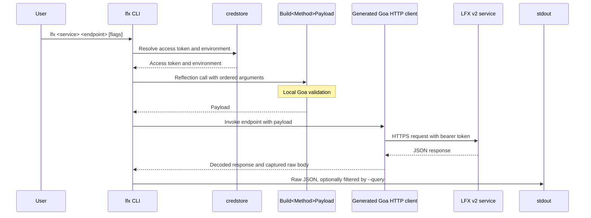
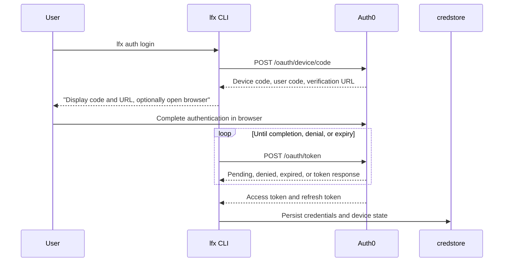

# Architecture

This document describes contributor-facing implementation contracts in the
LFX CLI. User-facing setup and command guidance belongs in
[README.md](README.md).

## Goa client wrapping pattern

LFX v2 services generate Goa HTTP clients, but `lfx` does not embed the
services' generated `gen/http/cli/...` packages. Those packages are designed
as standalone CLIs: they read global `os.Args`, call `os.Exit` for invalid
input, and write usage directly to stderr. That behavior cannot be safely
hosted inside the `urfave/cli` command tree used by `lfx`.

Instead, [`internal/commands/goa.go`](internal/commands/goa.go) provides a
small adapter around generated HTTP clients. A `goaService[C]` describes a
service command group: its name and usage, a `NewClient` constructor for the
generated HTTP client, and examples to render in command help.

A `goaEndpointSpec[C]` describes one endpoint exposed beneath that command
group. It holds the generated `Build<Method>Payload` function, an ordered
`[]goaBuilderArg` table, and the endpoint method to invoke on the generated
client. Each builder argument records the generated parameter name, its kind,
the corresponding flag, help text, and a default where appropriate. For
example, [`internal/commands/query.go`](internal/commands/query.go) maps the
query service's generated client and its endpoint builders into `lfx
query-svc` subcommands.

`endpointCommand` turns every non-token builder argument into a `urfave/cli`
flag and adds the shared `--query` / `-q` response-filtering flags. At runtime,
`goaService.run`:

1. Resolves an access token and logged-in environment through `lfx auth`.
2. Builds the environment's service base URL and verifies its transport
   requirements.
3. Converts flags into the ordered builder arguments and calls the generated
   `Build<Method>Payload` function through `callGoaBuilder` reflection. Goa's
   generated builder therefore remains responsible for its normal parsing and
   validation.
4. Calls the generated client endpoint through a `rawBodyDoer`, which retains
   the exact response body while the generated client decodes it.
5. Writes that raw body to stdout, or writes its `--query`-filtered view.

`TestGoaBuilderSignatures` in
[`internal/commands/goa_test.go`](internal/commands/goa_test.go) parses each
generated builder's source and compares its parameter names, in order, with
the spec's `Args` table. This detects a reordered, renamed, added, or removed
parameter that could otherwise compile while silently sending a flag value to
the wrong argument. When an LFX v2 service module changes, follow
[`.agents/skills/upgrade-maintenance/SKILL.md`](.agents/skills/upgrade-maintenance/SKILL.md)
to reconcile these tables.

## Authentication flow

[`internal/commands/auth.go`](internal/commands/auth.go) implements Auth0's
Device Code flow. `lfx auth login` calls `oauth2.Config.DeviceAuth` to request
a device code from Auth0. It displays the user code and verification URL, and
with `--web` may open the URL in the default browser. It then calls
`DeviceAccessToken`, which polls until the user completes authentication,
denies the request, or the device code expires.

After a successful login, the CLI persists the refresh token and, when
provided, a cached access token and expiry using `credstore`. `lfx auth token`
and other authenticated commands use `resolveAccessToken`: it returns a valid
cached access token when available or exchanges the stored refresh token for a
fresh token and persists the refreshed credentials. It also returns the
logged-in environment. Both raw `lfx api` calls and Goa-backed service
commands use that environment to select their service audience.

## Security controls

The following controls are implementation contracts for contributors. They
are documented here because they are internal safeguards rather than
user-actionable README guidance.

- **Verification URL validation before browser launch.**
  `validateBrowserURL` and `openBrowser` in
  [`internal/commands/auth.go`](internal/commands/auth.go) handle the device
  flow's `verification_uri` and `verification_uri_complete`, which come from
  the Auth0 response rather than from the user. Before `lfx auth login --web`
  launches an OS browser, the CLI accepts only absolute HTTPS URLs with a
  hostname. Any other URI is displayed for manual inspection instead of being
  launched. Login instructions pass IdP-provided text through
  `terminalSafeText`, which escapes control characters. Together, these
  measures prevent a compromised or misbehaving IdP response from launching a
  local file or custom URI scheme, or from injecting terminal control output.

- **HTTPS enforcement for outbound authenticated requests.**
  `apiRequireHTTPS` in
  [`internal/commands/api.go`](internal/commands/api.go) is used by `lfx api`
  and every Goa-backed service command. Because the bearer token is carried in
  the `Authorization` header, the CLI refuses non-HTTPS base URLs, except for
  loopback hosts used by local development and mock servers.

- **No redirect following.**
  `newNoRedirectHTTPClient` in
  [`internal/commands/api.go`](internal/commands/api.go) disables automatic
  redirects. Go's default HTTP client can retain an `Authorization` header on
  a same-host redirect even when it changes from HTTPS to HTTP; following that
  redirect would expose the bearer token in cleartext. The CLI instead returns
  a 3xx response to its caller like any other status.

- **Fixed base URL for each environment.**
  `lfx api` and Goa-backed commands derive their base URL from the compiled-in
  default API audience for the environment recorded at login; see `lfx auth
  environments`. They expose no per-call base-URL override. This forms a trust
  boundary: command flags cannot redirect an authenticated request to an
  arbitrary host.

- **Response body size cap for Goa-backed commands.**
  `maxGoaResponseBodyBytes` and `rawBodyDoer.Do` in
  [`internal/commands/goa.go`](internal/commands/goa.go) cap the fully
  buffered response body at 64 MiB. Goa-backed commands retain the full body
  to print it verbatim, while the generated client itself does not impose that
  limit; the cap prevents unbounded memory consumption.
